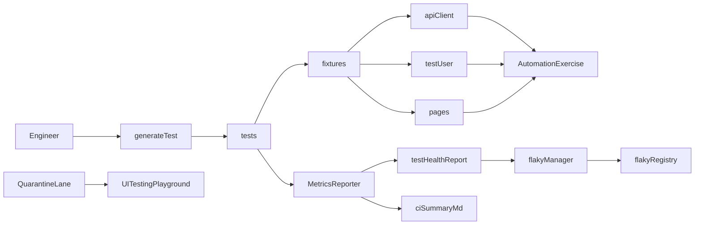

# QA Test Platform

This is the internal test platform for product engineers. It is built so the path of least resistance is a reliable test: generate a scaffold, pick the cheapest layer that proves the behavior, and let the platform isolate data, report health, and keep known flakes out of the merge gate.

## Philosophy

Prove a contract through the API before you open a browser. Each test that needs a person gets its own account, created and deleted through the API, so parallel runs do not share state. Quarantine does not block a pull request. Traces, screenshots, and video are kept only when a test fails.

## Architecture



## Quickstart

```bash
nvm use
npm ci
npx playwright install chromium
npm run test:api
npm run generate:test
npx playwright show-trace path/to/trace.zip
```

`npm run generate:test` asks for a domain, a layer, and a risk tag. Pass `--domain`, `--layer`, `--risk`, and `--name` to skip the prompts.

## Where things live

- `src/fixtures` — `apiClient`, `testUser`, and lazy page objects
- `src/api` — the typed client and Zod contracts
- `src/pages` — home, auth, products, and cart
- `src/reporters` — the health report and the CI summary
- `scripts` — `generate:test` and `flaky:sync`
- `tests` — API, UI, and quarantine suites
- `.github/workflows/quality-gate.yml` — the merge pipeline

## CI

`quality-gate.yml` has four jobs.

- `static-and-smoke` typechecks, lints, and runs `@api` and `@smoke`. It blocks merge.
- `regression` runs `@regression` across three shards. It blocks merge.
- `merge-reports` merges the shard blobs into one HTML report. It blocks merge.
- `quarantine` runs `@quarantine` with `continue-on-error`. It does not block merge, and it must not be marked as a required status check.

Read [docs/CONTRIBUTING_TESTS.md](docs/CONTRIBUTING_TESTS.md) before adding a test, and [docs/ADR-001-test-isolation-and-gating.md](docs/ADR-001-test-isolation-and-gating.md) for why the gate is shaped this way.
