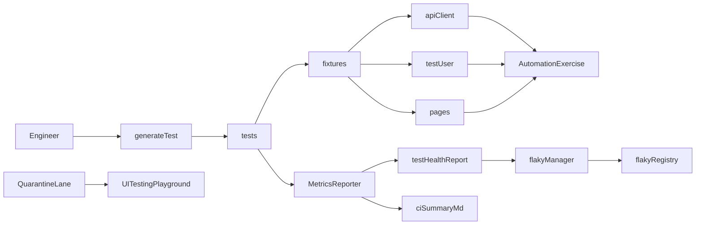

# QA Test Platform

This is the internal test platform for product engineers. It is built so the path of least resistance is a reliable test: generate a scaffold, pick the cheapest layer that proves the behavior, and let the platform isolate data, report health, and keep known flakes out of the merge gate.

## Philosophy

Prove a contract through the API before you open a browser. Each test that needs a person gets its own account, created and deleted through the API, so parallel runs do not share state. Quarantine does not block a pull request. Traces, screenshots, and video are kept only when a test fails.

## Architecture



## Quickstart

```bash
nvm use
npm ci
npx playwright install chromium
npm run test:api
npm run generate:test
npx playwright show-trace path/to/trace.zip
```

`npm run generate:test` asks for a domain, a layer, and a risk tag. Pass `--domain`, `--layer`, `--risk`, and `--name` to skip the prompts.

## Ask the agent to write the test

In Cursor, describe the behavior and the risk. You do not choose the framework. Example prompt:

```text
Add a test that searching for "top" returns products. Domain catalog, risk regression.
```

The `author-test` skill (`.cursor/skills/author-test/SKILL.md`) then:

1. Picks the cheapest layer. A search contract stays on the API. A screen with no API equivalent is UI. A screen that must show an account created through the API is hybrid, tagged `@ui` only.
2. Runs `npm run generate:test` with `--domain`, `--layer`, `--risk`, and `--name`.
3. Replaces the `test.skip` scaffold with Arrange, Act, and Assert, using `apiClient`, `testUser`, and `pages`.
4. Runs that spec and reads `reports/ci-summary.md` before it says the test is done.

A short rule in `.cursor/rules/test-platform.mdc` is always on, so any agent in this repo keeps one layer tag, refuses a shared user, and reuses the page objects. The full authoring rules are in [docs/CONTRIBUTING_TESTS.md](docs/CONTRIBUTING_TESTS.md).

## Ask the agent to explain a failure

Traces are kept on failure. The zip is `test-results/**/trace.zip`. Example prompt:

```text
The checkout test failed. Open its trace and tell me which action broke.
```

The `playwright-trace` skill (`.cursor/skills/playwright-trace/SKILL.md`) reads that zip from the terminal: failed actions, the DOM at that step, failed requests, and console errors. It does not open the Trace Viewer. Read `reports/ci-summary.md` first. `failureClass` decides the first command: a missing locator looks at the DOM before the action, an assertion looks at the DOM after it, and a timeout looks at failed requests and console errors.

`npm run trace:install-skill` recopies the skill shipped with the installed Playwright into `.cursor/skills/playwright-trace/`. `npx playwright trace install-skill` writes a Claude copy under `.claude/skills/` and does not update the Cursor skill.

## Where things live

- `src/fixtures` — `apiClient`, `testUser`, and lazy page objects
- `src/api` — the typed client and Zod contracts
- `src/pages` — home, auth, products, and cart
- `src/reporters` — the health report and the CI summary
- `scripts` — `generate:test` and `flaky:sync`
- `tests` — API, UI, and quarantine suites
- `.cursor/skills/author-test` — the agent that writes a new test
- `.cursor/skills/playwright-trace` — the agent that inspects a failure trace
- `.cursor/rules/test-platform.mdc` — the constraints every agent in this repo follows
- `.github/workflows/quality-gate.yml` — the merge pipeline

## CI

`quality-gate.yml` has four jobs.

- `static-and-smoke` typechecks, lints, and runs `@api` and `@smoke`. It blocks merge.
- `regression` runs `@regression` across three shards. It blocks merge.
- `merge-reports` merges the shard blobs into one HTML report. It blocks merge.
- `quarantine` runs `@quarantine` with `continue-on-error`. It does not block merge, and it must not be marked as a required status check.

Read [docs/CONTRIBUTING_TESTS.md](docs/CONTRIBUTING_TESTS.md) before adding a test, and [docs/ADR-001-test-isolation-and-gating.md](docs/ADR-001-test-isolation-and-gating.md) for why the gate is shaped this way.
